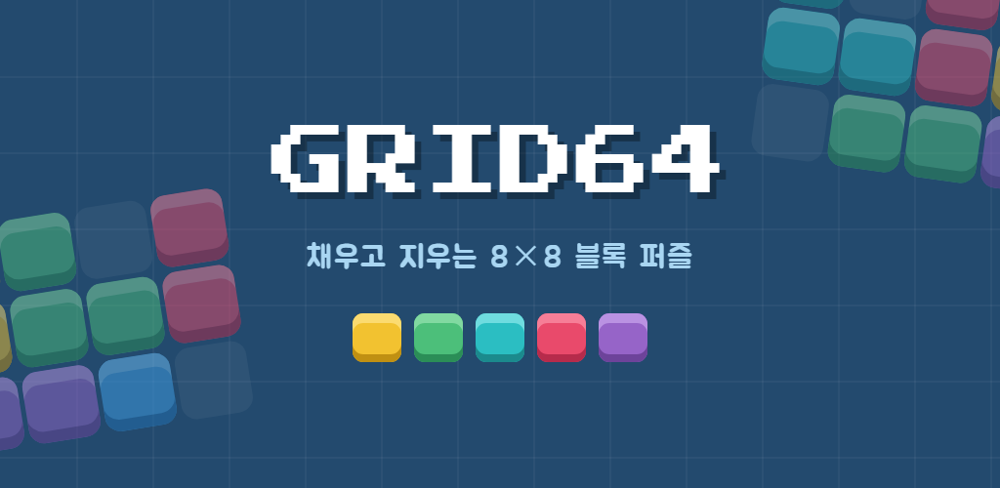
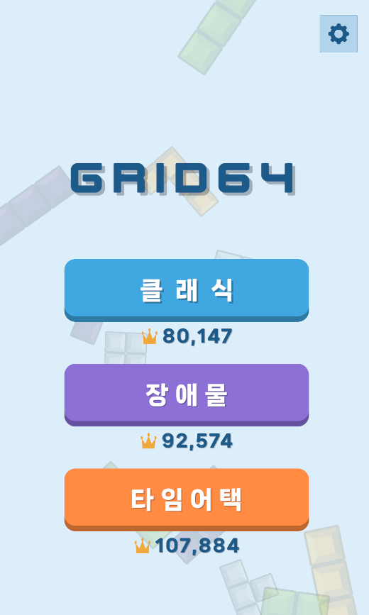
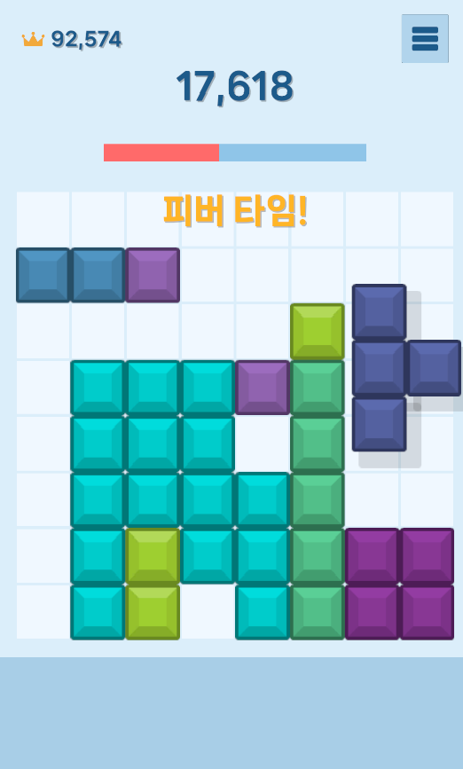
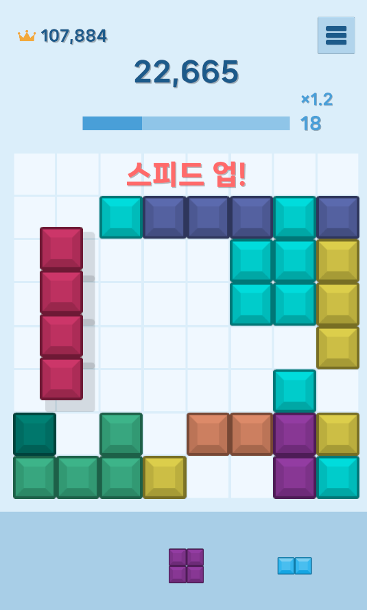
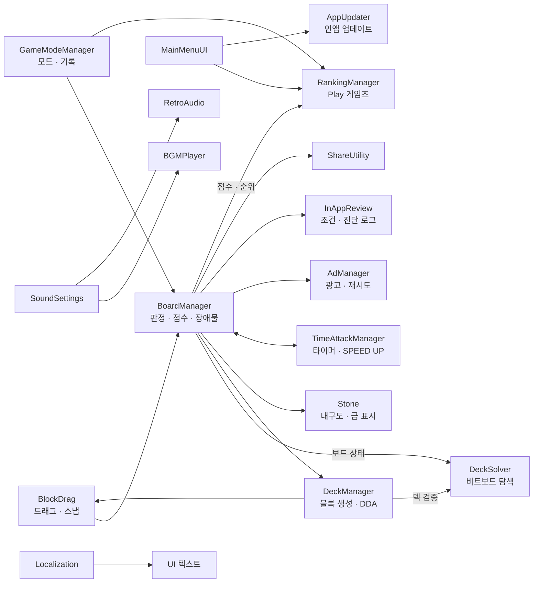

# Grid64 : 블록 퍼즐

> 8×8 보드를 채우고 지우는 블록 퍼즐. 느긋한 **클래식**, 시간에 쫓기는 **타임어택**, 돌덩이를 깨며 버티는 **장애물** 세 가지 모드와 모드별 **리더보드**.
> 기획부터 개발, 디자인, 테스트, Google Play 출시와 업데이트까지 1인으로 진행한 첫 프로젝트입니다.

<p align="center">
  
</p>

<p align="center">
  
  
  
</p>

<p align="center">
  <a href="https://play.google.com/store/apps/details?id=com.jiniworks.grid64">Google Play에서 받기</a> ·
  <a href="https://jininh.github.io/grid64/">소개 페이지</a>
</p>

---

## 프로젝트 정보

| 항목 | 내용 |
|---|---|
| 장르 | 캐주얼 블록 퍼즐 (세로, 한 손 조작) |
| 기간 | 2026.07 ~ 진행 중 (2026.10 출시, 현재 1.4.0) |
| 인원 | 1인 (기획 · 개발 · UI 디자인 · QA · 출시 · 운영) |
| 엔진 / 언어 | Unity 6.3 LTS / C# |
| 플랫폼 | Android (Google Play) |
| 연동 | Google Play 게임즈 서비스 v2 (리더보드), Google AdMob (배너 · 전면 · 보상형), Play In-App Review · In-App Updates, Android 공유 인텐트 |
| 지원 | 한국어 / 영어, 폴더블 · 태블릿 화면 |

## 주요 기능

- **클래식 모드**: 콤보, 교차 클리어(Perfect), 피버 타임(점수 2배), 올 클리어 보너스
- **타임어택 모드**: 줄을 지우면 시간 획득, 1분 후 30초마다 SPEED UP(시간 흐름 최대 ×1.5, 점수 배수 최대 ×2.0)
- **장애물 모드** (1.3.0): 일반 블록이 깔린 보드에서 시작, 턴이 지날수록 내구도 1~3의 돌덩이가 생성. 줄 클리어로 깨뜨리면 보너스
- **풀 수 있는 덱 보장** (1.3.0): 덱 3개를 어떤 순서로든 모두 놓을 수 있을 때만 출제 — 운이 아닌 실력으로 끝나도록
- **리더보드** (1.4.0): Google Play 게임즈 모드별 리더보드 3개. 자동 로그인, 로그인 전 기록 동기화, 게임오버 화면에 "내 순위 N위"
- **인앱 업데이트** (1.4.0): 출시 3일이 지난 새 버전만 안내, 플레이 중 백그라운드 다운로드 후 메인 메뉴에서 재시작
- **동적 난이도(DDA)**: 보드의 빈칸 비율에 따라 블록 등장 가중치 조절
- **광고 부활**: 데드락 시 보상형 광고로 1회 부활 (5초 카운트다운, 자동 재생 없음)
- **기록 공유 · 인앱 리뷰**: 게임오버 화면에서 기록 공유, 조건을 만족할 때만 별점 요청(요청할수록 간격 30 → 60 → 90일)

## 구조



| 구분 | 방식 |
|---|---|
| 게임 매니저 | 싱글톤 (`BoardManager`, `DeckManager`, `TimeAttackManager`, `AdManager`) |
| 전역 상태 | static 클래스 (`GameModeManager`, `SoundSettings`, `Localization`) + `Changed` 이벤트 |
| 외부 서비스 | static 또는 처음 필요할 때 스스로 생성 (`RankingManager`, `InAppReview`, `AppUpdater`) — 씬 배치 없이 동작, 실패해도 게임 진행에 영향 없음 |
| 알고리즘 | static 유틸리티 (`DeckSolver` — 64비트 비트보드) |
| 밸런스 데이터 | 인스펙터 편집용 직렬화 클래스 (`StoneTier` 턴별 난이도 표) |
| 저장 | PlayerPrefs (모드별 최고 기록, 서버 동기화 기록, 음량, 언어, 리뷰 요청 이력) |

## 문제 해결 사례

### 1. "운이 나빠서 지는" 덱 문제 — 비트보드 시뮬레이션
- **문제**: 장애물 모드 테스트 중 "첫 블록을 놓으면 나머지 둘이 들어갈 자리가 없는" 판이 잦아, 어렵다기보다 운이 없다고 느껴짐. 기존 덱 검사는 블록을 **각각 따로** 놓을 수 있는지만 확인해서, 하나를 놓은 뒤의 상황은 보장하지 못함
- **해결**: 8×8 보드를 **64비트 정수 하나(비트보드)**로 표현. 블록이 들어가는지는 `(board & piece) == 0` 한 번의 연산, 줄 클리어는 가로·세로 16개 마스크 비교로 계산. 덱 3개를 모든 순서·위치로 놓아 보며 **중간 줄 클리어까지 반영**해 전부 놓을 수 있는 경로가 있는지 재귀 탐색하고, 없으면 덱을 다시 뽑음 (최대 30회)
- **최적화**: 프리팹별 배치 마스크를 한 번만 계산해 캐시, 같은 모양 블록은 탐색 중복 제거, 마지막 블록은 들어가기만 하면 즉시 성공 처리
- **결과**: 첫 덱 2.5ms(캐시 생성), 이후 덱당 **0.1ms 미만**. 계산량 때문에 보류했던 기능을 전 모드에 적용. 타임어택은 데드락 감소로 목표 점수대(10만점) 도달
- **코드**: [`DeckSolver.cs`](Scripts/DeckSolver.cs), [`BoardManager.IsDeckSolvable()`](Scripts/BoardManager.cs), [`DeckManager.PickDeck()`](Scripts/DeckManager.cs)
- **배운 점**: 불공정하게 느껴지는 패배는 숫자 조정이 아니라 구조로 막아야 한다. 자료구조를 바꾸면 "무거워서 못 하던" 기능이 가능해진다

### 2. 리더보드 로그인이 계속 "취소됨" — 플러그인 로그 대신 시스템 로그로 원인 찾기 (1.4.0)
- **문제**: Play 게임즈 로그인 창에서 프로필을 골라도 결과가 항상 `Canceled`. 플러그인 로그는 "Returning an error code."뿐이라 원인을 알 수 없었고, SHA-1·키스토어·인증 정보를 차례로 의심함
- **추적**: 서명 키 SHA-1을 keytool·Play Console·Google Cloud 세 곳에서 대조해 서명은 정상임을 확인. 앱 필터로는 Google Play 서비스 프로세스의 로그가 가려져서, `adb logcat`으로 기기 전체 로그를 파일로 뽑아 로그인 흐름을 따라감
- **원인**: `OAuth consent successful` 다음 `Unable to load player ... NOT_FOUND` → `Sign-in failed [10002] in state [LOAD_SELF]`. 인증은 통과했지만, 게시 전이라 **테스터로 등록되지 않은 계정**은 이 게임의 플레이어로 인식되지 않은 것
- **해결**: 테스터 계정으로 로그인해 즉시 성공. 출시 전에는 업로드 키·앱 서명 키·**이전 앱 서명 키**(서명 키 업그레이드 후 구형 기기용) 인증 정보를 모두 등록하고, 내부 테스트 트랙의 스토어 설치본으로 실제 사용자와 같은 서명 경로를 검증
- **배운 점**: 외부 SDK 오류는 SDK 로그만 보지 말고 시스템 로그에서 흐름을 따라갈 것. "어디까지 성공했는지"를 찾으면 원인 범위가 좁혀진다

### 3. 출시 후 자녀 폰에서만 순위가 안 뜸 — 실패해도 게임은 계속되게 (1.4.0)
- **현상**: 일반 계정은 정상인데 Family Link 자녀 계정에서는 로그인은 되지만 공개 리더보드에 점수가 표시되지 않음. 같은 기기에서 전면·보상형 광고도 거의 채워지지 않았음
- **원인**: 보호자 관리 계정은 Google이 공개·소셜 기능과 광고를 제한함 (앱 대상 연령은 만 13세 이상)
- **설계**: 외부 서비스는 실패를 정상 경로로 다룸. 순위 조회는 결과를 모르면 0을 돌려주고, 게임오버 버튼은 "🏆 ..." → "내 순위 N위" 또는 "🏆 랭킹"으로 자연스럽게 정리. 로그인 전 기록은 로그인 순간 한꺼번에 동기화
- **코드**: [`RankingManager.cs`](Scripts/RankingManager.cs), [`BoardManager.OnRankLoaded()`](Scripts/BoardManager.cs)
- **배운 점**: 테스트 기기의 계정 종류도 테스트 조건이다. 기능 확인은 일반 계정, 자녀 계정은 "제한돼도 멈추지 않는지" 확인용으로 나눠 쓴다

### 4. 장애물 밸런스를 점수 기준에서 턴 기준으로
- **문제**: 처음에는 "점수가 오를수록 돌이 단단해지게" 설계했으나, 한 줄이 800점이라 기준(3,000점)을 초반에 바로 넘김. 피버·콤보로 판마다 점수 상승 속도도 크게 달랐음. 또 아무 줄이나 지웠을 때 특정 돌이 맞을 확률이 약 1/8이라, 2턴마다 생기는 돌이 지워지는 속도보다 빨리 쌓임
- **해결**: 난이도 기준을 **턴(덱 리스폰 횟수)**으로 바꾸고, 구간별 생성 간격·동시 최대·내구도 비율을 인스펙터 표(`StoneTier[]`)로 분리. 긴장감은 시작 배치(일반 블록 14~18칸)가 맡고, 돌은 천천히 늘다가 후반에 2개씩 생성. 돌을 놓을 자리도 "덱을 다 놓을 수 있는 칸"으로 제한
- **코드**: [`BoardManager.SpawnStonesForTurn()`](Scripts/BoardManager.cs), [`Stone.cs`](Scripts/Stone.cs)

### 5. 타임어택 데드락 구제가 실패하던 문제
- **문제**: 막혔을 때 가로 3줄만 비워줬더니, 덱에 세로로 긴 블록만 남은 경우 여전히 놓을 곳이 없어 시간만 흐르다 종료됨
- **해결**: 가로·세로 6개 후보 영역을 **가상으로 비워본 뒤 덱의 블록이 실제로 들어가는 곳만** 선택. 구제 후 다시 검사하고 실패하면 최대 3회 재시도
- **코드**: [`BoardManager.RescueBoard()`](Scripts/BoardManager.cs), [`TimeAttackManager.OnDeadlock()`](Scripts/TimeAttackManager.cs)
- **배운 점**: "해결했다"고 가정하지 말고 결과를 검증할 것. 상태가 막힐 수 있는 경로에는 탈출구를 둘 것

### 6. 언어 변경 후 글자가 □로 깨지던 문제 (출시 후 발견)
- **문제**: 영어로 바꿨다가 한국어로 돌아오면 게임오버·부활 패널 등 일부 글자가 □로 표시됨
- **원인**: TextMeshPro 동적 폰트 아틀라스가 1024×1024에 Sampling 90이라 글자 칸이 커서 **약 80자**만 들어감. 한글과 영문이 함께 쌓이자 아틀라스가 가득 차 새 글자를 그리지 못함
- **해결**: Sampling 64 / Atlas 2048 / **Multi Atlas Textures** 활성화 (한 장에 약 1,000자, 넘치면 아틀라스 자동 추가)
- **배운 점**: "처음엔 멀쩡하다가 나중에 일부만 깨진다"면 리소스 포화를 의심할 것

### 7. 광고가 한 번 실패하면 세션 내내 안 나오던 문제 (출시 후 발견)
- **문제**: 보상형 광고를 앱 시작 때 한 번만 불러와, 실패하면 앱을 다시 켤 때까지 부활 제안이 나오지 않음
- **해결**: 실패 시 **5 → 10 → 20 → 40 → 60초** 간격으로 플레이 중 재시도(게임오버 중에도 흐르도록 실시간 기준), 중복 로드 방지, 씬 전환 시 예전 배너 요청의 재시도가 새 배너를 지우지 않도록 요청 ID로 구분. 비행기 모드로 실패 → 복구 과정을 Logcat으로 검증
- **코드**: [`AdManager.cs`](Scripts/AdManager.cs)

### 8. 폴더블 · 태블릿에서 화면이 잘리던 문제
- **문제**: 테스터의 폴더블 펼침 화면에서 덱이 사라지고 상단 UI가 잘림
- **해결**: 카메라 크기를 `max(가로 기준, 9:16 세로 기준)`으로 자동 계산하고, Canvas Scaler를 Expand로 변경
- **코드**: [`CameraFitter.Fit()`](Scripts/CameraFitter.cs)

### 9. 고득점 플레이 중 보드가 한쪽으로 밀리던 문제
- **원인**: 겹치는 흔들림 연출이 "흔들리는 도중의 위치"를 원위치로 저장해 오차가 누적
- **해결**: 원위치는 흔들림이 없을 때만 저장하고, 항상 고정 기준값에서 오프셋을 줌
- **배운 점**: 겹칠 수 있는 연출은 현재 값이 아닌 고정 기준값을 기준으로 할 것

## 출시 및 운영

- 비공개 테스트: 지인 약 30명, 14일 이상 운영. 피드백을 **버그 / 편의성 / 재미** 3가지로 분류해 반영
- 1.2.4 프로덕션 출시 (2026.10) → 1.3.1 장애물 모드·풀 수 있는 덱·광고 안정성·폰트 수정 → **1.4.0 리더보드·인앱 업데이트·리뷰 개선**
- 업데이트 전 **내부 테스트 트랙**으로 스토어 설치본 검증 후 프로덕션 승격 (1.4.0은 Play 서명 로그인 경로를 여기서 확인)
- 개인정보처리방침(데이터 삭제 방법 포함), 오픈소스 라이선스 고지, app-ads.txt를 GitHub Pages로 직접 구성하고 Play 데이터 보안 양식과 맞춰 관리

## 폴더 안내

```
Scripts/        게임 스크립트 (원본 프로젝트의 Assets/Scripts)
docs/images/    그래픽 이미지, 스크린샷
```

> 이 저장소는 포트폴리오용으로 스크립트만 공개합니다. 씬, 프리팹, 그래픽, 사운드, 플러그인 등 에셋은 포함하지 않아 단독으로 빌드되지 않습니다. 광고 단위 ID는 가려져 있으며, Play 게임즈 리더보드 ID 상수(`GPGSIds.cs`, 자동 생성)는 제외했습니다.

## 라이선스 및 크레딧

- 폰트: 나눔스퀘어 네오 (SIL OFL 1.1)
- 효과음 · 배경음: Kenney (CC0), Pixabay (Pixabay Content License)
- 전체 고지: [오픈소스 라이선스](https://jininh.github.io/jiniworks-privacy/grid64-licenses.html)

---

**JiniWorks** · [개발자 홈](https://jininh.github.io)
